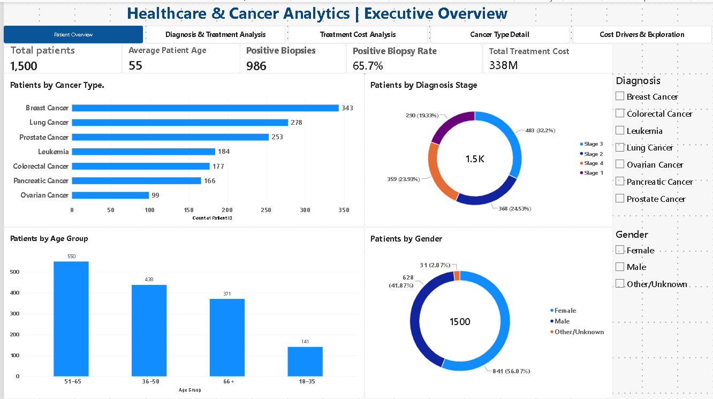
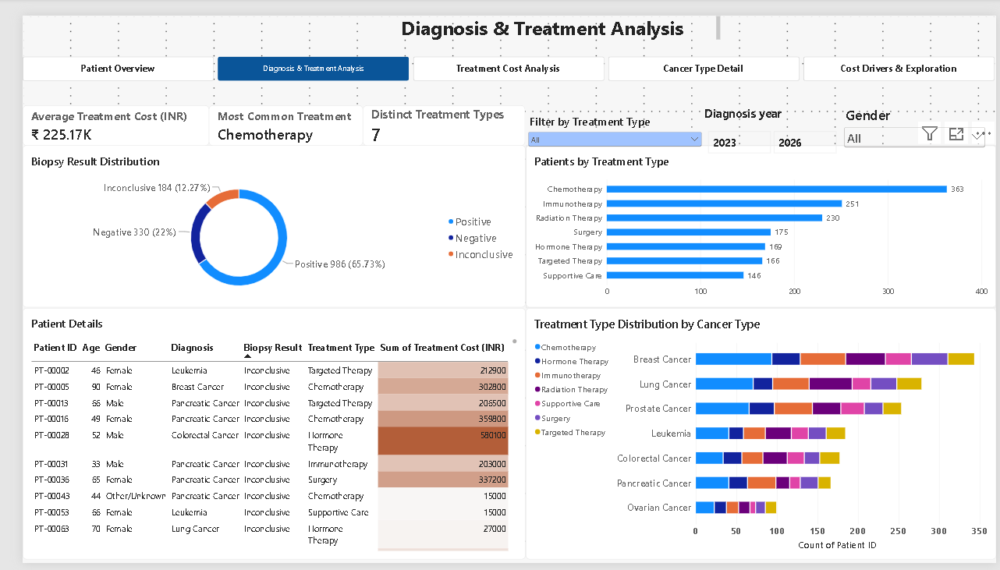
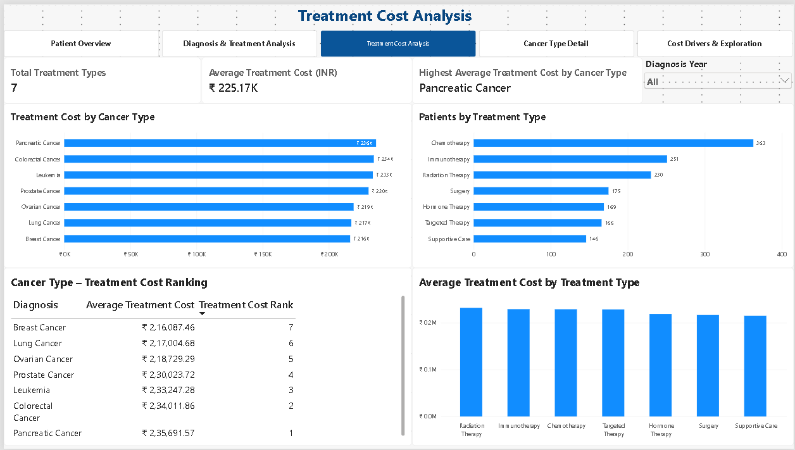
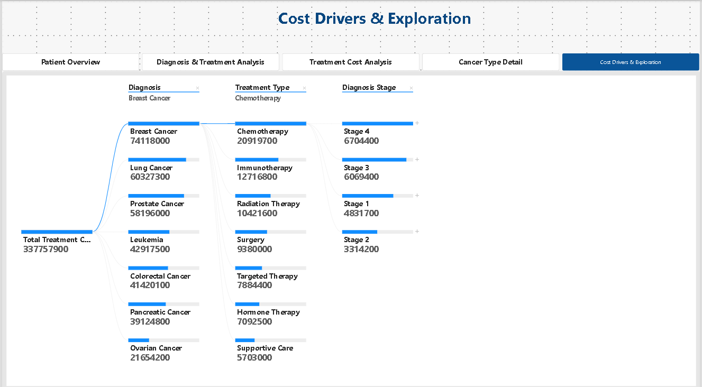

# Healthcare-Cancer-Analytics-PowerBI


## Project Overview
Developed an interactive Healthcare & Cancer Analytics Dashboard using Power BI to explore patient demographics, cancer types, diagnosis stages, biopsy results, treatment patterns, and treatment costs.

The project demonstrates how data analytics and visualization can support exploratory analysis and healthcare reporting.
## Dashboard Preview

### 1. Patient Overview


### 2. Diagnosis & Treatment Analysis


### 3. Treatment Cost Analysis


### 4. Cost Drivers & Exploration



## Business Objectives
- Analyze patient demographics and cancer-type distribution.
- Understand biopsy result patterns.
- Explore treatment distribution across cancer types.
- Compare treatment costs across cancer types and treatment categories.
- Identify cost patterns using interactive analytical tools.

## Dataset
- 1,500 synthetic patient records.
- 24 variables covering patient demographics, diagnosis, biopsy results, treatment details, and costs.
- The dataset is synthetic and does not represent real patients or clinical outcomes.

## Tools & Technologies
- Power BI Desktop
- DAX
- Data Modeling
- Data Visualization
- Interactive Slicers and Filters
- Custom Tooltips
- Drill-through Analysis
- Decomposition Tree

## Dashboard Pages

### 1. Patient Overview
Explores patient demographics, age groups, gender distribution, cancer types, diagnosis stages, and key patient KPIs.

### 2. Diagnosis & Treatment Analysis
Analyzes biopsy results, treatment patterns, treatment distribution across cancer types, and patient-level details.

### 3. Treatment Cost Analysis
Compares average treatment costs by cancer type and treatment category, including dynamic cost rankings.

### 4. Cost Drivers & Exploration
Uses a Decomposition Tree to explore treatment cost breakdowns by diagnosis, treatment type, and other dimensions.

### 5. Cancer Type Detail
Provides detailed analysis through drill-through functionality for individual cancer types.

## Advanced Power BI Features
- DAX measures for KPI calculations and dynamic rankings.
- Interactive slicers and cross-filtering.
- Custom report-page tooltips.
- Drill-through navigation.
- Decomposition Tree for cost-driver exploration.
- Page navigation for a structured reporting experience.

 ## Key DAX Measures

The dashboard uses DAX measures to calculate key performance indicators and support dynamic analysis.

**1. Total Patients**
```DAX
Total Patients =
DISTINCTCOUNT('Patient Data'[Patient ID])
```

**2. Positive Biopsy Rate**
```DAX
Positive Biopsy % =
DIVIDE([Positive Biopsies], [Total Patients], 0)
```

**3. Average Treatment Cost**
```DAX
Average Treatment Cost =
AVERAGE('Patient Data'[Treatment Cost (INR)])
```

**4. Treatment Cost Rank**
```DAX
Treatment Cost Rank =
RANKX(
    ALLSELECTED('Patient Data'[Diagnosis]),
    [Average Treatment Cost],
    ,
    DESC,
    DENSE
)
```
These measures support dynamic KPI reporting, percentage calculations, and comparative treatment cost analysis.

## Key Findings
- The dataset contains 1,500 synthetic patient records.
- Positive biopsy results account for 65.73% of records.
- Seven distinct treatment categories are represented.
- Treatment costs can be compared across cancer types and treatment categories.
- Interactive filtering allows exploration of patterns across diagnosis years and patient groups.

 ## Business Insights

- Positive biopsy results represent 65.73% of the synthetic patient records.
- Chemotherapy is the most common treatment category in the dataset.
- Pancreatic Cancer has the highest average treatment cost in the overall dataset.
- Treatment cost patterns vary across cancer types and treatment categories.
- Interactive filtering enables users to explore differences across diagnosis years and patient groups.

These observations are descriptive findings from the synthetic dataset and should not be interpreted as real-world clinical trends.

## Project Limitations
- The dataset is synthetic and intended for learning and demonstration.
- Observed patterns should not be interpreted as real-world clinical findings.
- The dashboard is exploratory and does not provide diagnostic or treatment recommendations.

 ## Project Outcome

Developed an interactive Power BI dashboard that transforms synthetic healthcare data into a unified analytical reporting solution. Enabled users to explore patient demographics, analyze biopsy results and treatment patterns, compare treatment costs across cancer types and treatment categories, and investigate cost drivers through interactive filters, DAX measures, drill-through functionality, custom tooltips, and Decomposition Tree analysis.

The project demonstrates the application of data analytics and business intelligence techniques to support exploratory healthcare data analysis and informed reporting.

## Project Files
- Power BI dashboard (.pbix)
- Dashboard PDF export
- Dashboard screenshots


